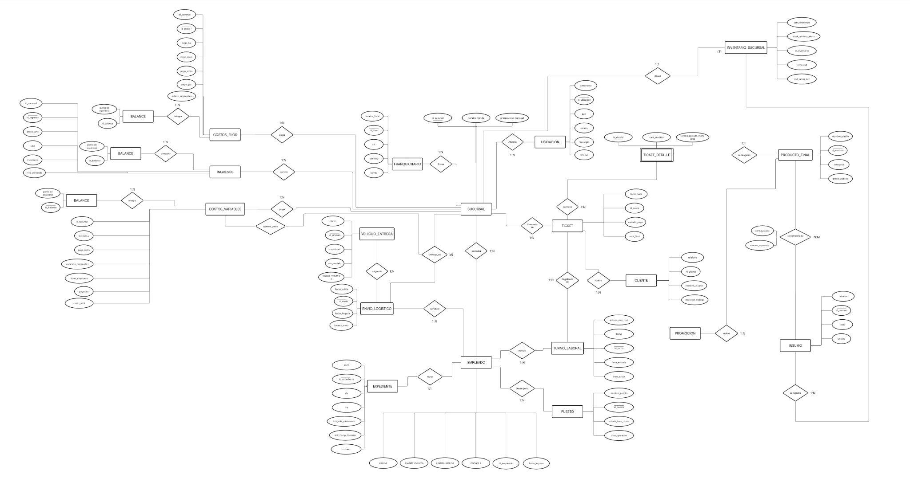
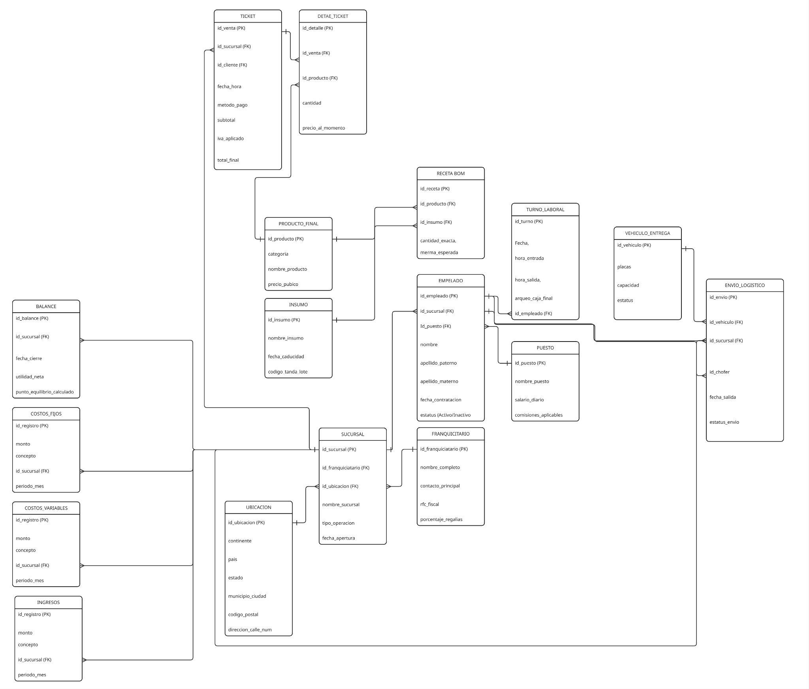
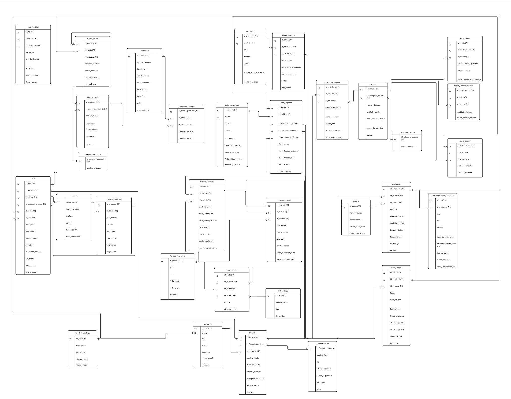

# Franchise Management Database (MySQL)

A relational database for a pizza franchise: stores, staff, inventory, purchasing, logistics, sales and finances. Built as a team of two with Diego Nuñez Guzman for my Databases course at Universidad de Monterrey (UDEM).

## What it covers

31 tables grouped by area:

| Area | Tables |
|---|---|
| Franchise and locations | `Franquiciatario`, `Ubicacion`, `Sucursal`, `Tasa_IVA_Catalogo` |
| Staff | `Puesto`, `Empleado`, `Documentacion_Empleado`, `Turno_Laboral` |
| Inventory and purchasing | `Categoria_Insumo`, `Insumo`, `Proveedor`, `Orden_Compra`, `Orden_Compra_Detalle`, `Inventario_Sucursal` |
| Products | `Categoria_Producto`, `Producto_Final`, `Receta_BOM` |
| Logistics | `Vehiculo_Entrega`, `Envio_Logistico`, `Envio_Detalle` |
| Sales and customers | `Cliente`, `Direccion_Entrega`, `Ticket`, `Ticket_Detalle`, `Promocion`, `Promocion_Producto` |
| Finance | `Periodo_Financiero`, `Partida_Costo`, `Costo_Sucursal`, `Ingreso_Sucursal`, `Balance_Sucursal` |

## Database design

The tables are normalized to Third Normal Form. We modeled the database with three diagrams.

Entity-relationship diagram:



Crow's Foot diagram:



Relational model:



## SQL concepts used

- Primary, foreign and unique keys, plus `CHECK` constraints to validate data (for example, percentages between 0 and 100, store status limited to a fixed list)
- Nine reporting **views** with joins and aggregations (`SUM`, `AVG`, `COUNT`, `GROUP BY`), such as sales by store, critical inventory, shipments, and profitability and ranking by store
- **Role-based access control:** 10 MySQL users (administrator, programmer, auditor, store manager, HR, sales, inventory, logistics, finance, end customer), each with only the permissions and views their job needs
- Sample data to try every view

## How to run

Requires MySQL 8.0.16 or later, which is when `CHECK` constraints started to be enforced.

```
mysql -u <user> -p < schema.sql
```

The script recreates the `LittleCeasarsDB` database from scratch, creates the tables, loads sample data, creates the views and sets up the users. Then try:

```sql
USE LittleCeasarsDB;
SELECT * FROM vw_reporte_ventas_sucursal ORDER BY total_vendido DESC;
```

The demo passwords in the script are for local testing only.

## My contribution

We designed the schema together through brainstorming, and I wrote most of the SQL code. To plan it, we normalized the tables in Excel to visualize them, and used notes from our business courses so that each view answers a real business question.

## What I learned

Modeling a business with many related entities, enforcing rules inside the database, and using views and permissions so each role only sees what it needs.
